# 🛡️ Awesome Autonomous Threat Management

  

  
  
  
  
  

---

## 📑 Curated Directory of Autonomous Cybersecurity, XDR, EDR & Automated SecOps

> **Autonomous Threat Management (ATM)** combines machine learning, self-learning behavioral analytics, threat intelligence feeds, and automated orchestration (SOAR/XDR) to identify, investigate, contain, and remediate cyber threats across endpoints, networks, identities, and multi-cloud infrastructure in real time with minimal human latency.

**Last updated:** October 2026

Contributions are welcome! Please read the [contribution guidelines](#-how-to-contribute) before submitting a pull request.

---

## 🗺️ Table of Contents

- [📊 Sector Overview & Market Dynamics](#-sector-overview--market-dynamics)
- [☁️ SaaS & Hosted Enterprise Platforms](#️-saas--hosted-enterprise-platforms)
- [🔓 Open-Source GitHub Projects](#-open-source-github-projects)
- [🏗️ Recommended Architecture & Frameworks](#️-recommended-architecture--frameworks)
- [🤝 How to Contribute](#-how-to-contribute)
- [💖 Support & Sponsorship](#-support--sponsorship)
- [📈 Star History](#-star-history)
- [⚠️ Disclaimer](#️-disclaimer)

---

## 📊 Sector Overview & Market Dynamics

The global security automation and autonomous threat management sector is estimated at **$11.8B – $13.6B in 2025/2026**, projected to surge past **$22.9B by 2030 at a 14.0% CAGR**, driven by pervasive AI agent adoption and automated SOC operations. The market exhibits a **moderately consolidated structure at the core platform tier** dominated by massive cybersecurity ecosystems (Palo Alto Networks, CrowdStrike, ServiceNow), while remaining **highly fragmented across niche innovation vectors** (agentic threat triage, runtime anomaly engines, identity threat detection, and specialized open-source frameworks).

---

## ☁️ SaaS & Hosted Enterprise Platforms

The table below benchmarks enterprise SaaS and cloud platforms delivering automated and autonomous threat detection, investigation, and incident response. Products are sorted descending by company scale (**Market Capitalization / Enterprise Valuation**).

| Product / Vendor | Company Size (Valuation / Market Cap & Revenue) | Description & Autonomous Capabilities | Pricing (Starting Tier) | Free Tier / Trial Limit |
| :--- | :--- | :--- | :--- | :--- |
| **[Palo Alto Networks Cortex](https://www.paloaltonetworks.com/cortex)** | **~$315B Market Cap** (~$11.5B TTM Rev) | Cloud-native SecOps & XDR platform (Cortex XDR / XSIAM) correlating telemetry across endpoints, network, and cloud with AI-driven autonomous incident stitching and automated triage. | Starts at **$40 – $90 / endpoint / year** (entry-level Cortex XDR Prevent / Pro quotes via sales/channel) | **30-day Proof of Concept (PoC)** evaluation with dedicated engineering support (no perpetual free tier) |
| **[CrowdStrike Falcon](https://www.crowdstrike.com/)** | **~$265B Market Cap** (~$4.8B TTM Rev) | Cloud-delivered endpoint protection & automated XDR engine using Charlotte AI and behavioral indicators of attack (IOAs) for sub-minute autonomous threat containment. | Starts at **$5.00 / endpoint / month** (billed annually at $59.99/year for Falcon Go; Falcon Pro at $8.33/endpoint/month) | **15-day free trial** with full access to Falcon prevention & detection engine (no credit card required; up to 50 endpoints) |
| **[ServiceNow Autonomous Threat Management](https://www.servicenow.com/)** | **~$155B Market Cap** (~$14.7B TTM Rev) | Comprehensive enterprise SecOps suite combining Now Assist generative AI, automated playbook workflows, SIR (Security Incident Response), and vulnerability orchestration. | Starts at **$11,000 / fulfiller user / year** (baseline SecOps Standard; ITOM nodes from ~$0.50 – $1.50/node/month) | **No perpetual free tier**; custom **30-day guided Proof of Concept (PoC)** sandbox available via enterprise sales inquiry |
| **[SentinelOne](https://www.sentinelone.com/)** | **~$8.8B Market Cap** (~$900M TTM Rev) | Autonomous Singularity XDR platform deploying behavioral AI agents directly on endpoints for real-time automated detection, machine-speed mitigation, and 1-click rollback. | Starts at **$5.83 / endpoint / month** (billed annually at ~$69.99/year per endpoint for Singularity Core; Singularity Control at ~$99/year) | **14-day free trial** with full Singularity XDR capabilities across lab endpoints upon demo verification |
| **[Darktrace](https://www.darktrace.com/)** | **$5.3B Acquisition Valuation** (~$545M ARR) | Cyber AI platform utilizing unsupervised self-learning AI to detect novel and zero-day attacks, activating autonomous surgical response (Darktrace Antigena) in seconds. | Enterprise deployments typically start around **$25,000 – $30,000 / year** baseline for SMB/mid-market network/cloud coverage | **30-day Proof of Value (PoV)** trial deployed non-intrusively in live production network environments |
| **[Sophos](https://www.sophos.com/)** | **$3.9B Acquisition Valuation** (~$1.0B ARR) | Intercept X and Sophos XDR integrate deep learning neural networks, anti-ransomware CryptoGuard, and automated synchronized security response across endpoints and firewalls. | Starts at **$2.08 – $3.50 / endpoint / month** (~$25.00 – $42.00/year per endpoint via authorized MSP/partner tiers) | **30-day free trial** with full access to Sophos Central and Intercept X Advanced with XDR |
| **[Trellix](https://www.trellix.com/)** | **~$1.5B – $2.0B Private Rev** (STG Portfolio) | Extended detection and response platform fusing McAfee Enterprise and FireEye telemetry with adaptive learning and automated SOAR response playbooks. | Starts at **$2.17 – $3.33 / endpoint / month** (~$26.00 – $40.00/year per endpoint for Trellix Endpoint Essentials list price) | **60-day free evaluation** license via Trellix ePO Cloud / ePO-SaaS for pilot endpoint blocks |
| **[Vectra AI](https://www.vectra.ai/)** | **$1.2B Private Valuation** (~$120M ARR) | Network Detection and Response (NDR) and ITDR engine using patented Attack Signal Intelligence to prioritize urgent threats and trigger autonomous host quarantine. | Starts at **~$10,000 – $15,000 / year** baseline infrastructure licensing calculated by active IP hosts and network throughput | **45-day free trial** for Vectra Identity / ITDR module; 30-day custom enterprise NDR proof of concept |
| **[Cybereason](https://www.cybereason.com/)** | **~$850M Valuation** (~$100M ARR; LevelBlue) | Malop (malicious operation) engine that analyzes billions of endpoint events per second to autonomously correlate complex attack chains and execute immediate mitigation. | Starts at **$3.33 – $4.17 / endpoint / month** (~$40.00 – $50.00/year per endpoint baseline EDR for commercial accounts) | **No self-service free trial**; structured **30-day Proof of Concept (PoC)** available through enterprise sales / MSSP channel |
| **[Cynet](https://www.cynet.com/)** | **~$150M – $250M Valuation** (~$30M – $60M ARR) | All-in-one Autonomous Security Suite combining EDR, NDR, UBA, Deception, and Automated Incident Investigation & Remediation (auto-pilot response). | Starts at **$9.00 / endpoint / month** for the integrated Cynet 360 AutoX consolidated platform bundle | **14-day free trial** with full Cynet 360 automated prevention and incident remediation features enabled |

---

## 🔓 Open-Source GitHub Projects

Open-source threat detection, response orchestration, and observability engines enable transparent, self-hosted, and community-driven autonomous security pipelines. Repositories below are sorted descending by **GitHub Stargazer Count** and feature white social Stars_Badges linking directly to their stargazers page.

| Project & Repository | GitHub Stars_Count | Category / Domain | Description & Threat Management Role |
| :--- | :---: | :--- | :--- |
| **[osquery](https://github.com/osquery/osquery)** |  | Endpoint Visibility & Telemetry | SQL-powered operating system instrumentation framework. Exposes underlying OS state as a relational database to fuel automated intrusion detection scripts and host monitoring pipelines. |
| **[Wazuh](https://github.com/wazuh/wazuh)** |  | Unified XDR & SIEM Platform | Industry-leading open-source XDR and SIEM engine. Provides cross-platform endpoint agents, file integrity monitoring (FIM), vulnerability detection, rootkit scanning, and active response command automation. |
| **[Sigma](https://github.com/SigmaHQ/sigma)** |  | Universal Detection Engineering | The de facto standard generic signature format for automated detection engineering. Allows defenders to write rules once and automatically translate them into queries for Wazuh, Splunk, Elastic, Sentinel, and more. |
| **[OpenCTI](https://github.com/OpenCTI-Platform/opencti)** |  | Threat Intelligence Platform (TIP) | Unified open-source cyber threat intelligence management platform. Organizes cyber threats, indicators of compromise (IoCs), and tactics, integrating seamlessly with SOAR engines for automated enrichment. |
| **[Falco](https://github.com/falcosecurity/falco)** |  | Cloud-Native & Container Security | CNCF graduated runtime security engine that parses Linux kernel system calls via eBPF to detect unexpected application behaviors, privilege escalations, and container escapes in real time. |
| **[Maltrail](https://github.com/stamparm/maltrail)** |  | Malicious Traffic Detection | Lightweight malicious traffic detection system utilizing publicly available blacklists and heuristic algorithms to automatically flag C2 beacons, scanner activity, and malicious IP/domain contacts. |
| **[Zeek](https://github.com/zeek/zeek)** |  | Network Security Monitoring (NSM) | World-renowned behavioral network traffic analyzer. Converts raw network packets into structured protocol events, enabling automated scriptable anomaly detection and threat hunting at wire speed. |
| **[Suricata](https://github.com/OISF/suricata)** |  | Network IDS / IPS Engine | High-performance multi-threaded network threat detection, intrusion detection (IDS), intrusion prevention (IPS), and network security monitoring engine driven by community threat rule sets. |
| **[MISP](https://github.com/MISP/MISP)** |  | Threat Intelligence Sharing | Open-source platform for gathering, sharing, storing, and correlating indicators of compromise (IoCs) and threat intelligence across trusted security circles and automated blocklists. |
| **[Cuckoo Sandbox](https://github.com/cuckoosandbox/cuckoo)** |  | Automated Malware Analysis | Automated malware dynamic analysis system that safely detonates suspicious executables, PDFs, and payloads in isolated virtual environments and generates comprehensive behavioral reports. |
| **[DefectDojo](https://github.com/DefectDojo/django-DefectDojo)** |  | Vulnerability & Remediation Ops | DevSecOps and vulnerability management orchestration tool that automates security report ingestion, cross-tool vulnerability deduplication, and automated remediation tracking. |
| **[OSSEC](https://github.com/ossec/ossec-hids)** |  | Host-Based Intrusion Detection | Battle-tested open-source HIDS providing log analysis, file integrity verification, Windows registry monitoring, active response blocking, and rootkit detection. |
| **[Security Onion](https://github.com/Security-Onion-Solutions/securityonion)** |  | Integrated SOC & Threat Hunting | Turnkey open-source Linux distribution for threat hunting, network security monitoring, and log management. Pre-packs Suricata, Zeek, Wazuh, and the Elastic/OpenSearch stack. |
| **[Velociraptor](https://github.com/Velocidex/velociraptor)** |  | Endpoint Forensics & Hunting | Advanced digital forensics and incident response (DFIR) platform powered by Velociraptor Query Language (VQL) for lightning-fast cross-fleet telemetry collection and automated remediation. |
| **[TheHive](https://github.com/TheHive-Project/TheHive)** |  | Security Incident Response Platform | Scalable incident response platform designed for SOCs, CSIRTs, and CERTs to collaborate on active investigations, manage alert triage, and track containment workflows. |
| **[Elastic Detection Rules](https://github.com/elastic/detection-rules)** |  | SIEM Detection Rules | Production-ready detection and threat hunting rules developed and maintained by the Elastic Security team, targeting modern attacker techniques across cloud, Linux, Windows, and macOS. |
| **[OpenEDR](https://github.com/ComodoSecurity/openedr)** |  | Open-Source EDR Agent | Full-featured open-source endpoint detection and response telemetry agent delivering real-time event tracking, process analysis, and behavioral detection on Windows endpoints. |
| **[Shuffle](https://github.com/Shuffle/Shuffle)** |  | Open-Source SOAR | General-purpose, open-source Security Orchestration, Automation, and Response (SOAR) platform for building automated playbooks connecting SIEM, EDR, threat intel, and messaging systems. |
| **[Cortex (TheHive)](https://github.com/TheHive-Project/Cortex)** |  | Observable Analysis & Active Response | Companion engine to TheHive featuring 100+ analyzers and responders to automatically evaluate observable IoCs (IPs, hashes, URLs) and trigger containment actions across perimeter defenses. |

---

## 🏗️ Recommended Architecture & Frameworks

To construct an end-to-end, sovereign, and self-hosted autonomous threat detection pipeline:

1. **Endpoint Telemetry & Active Response:** Deploy **Wazuh** agents alongside **osquery** / **OpenEDR** for real-time telemetry, continuous log ingestion, and automated local agent mitigation (e.g., process termination, host isolation).
2. **Network Traffic & Container Anomaly Detection:** Ingest raw packets via **Suricata** (IDS/IPS signatures) and **Zeek** (protocol behavior), while running **Falco** with eBPF probes on Kubernetes nodes for runtime container protection.
3. **Detection Engineering Standard:** Standardize rule creation with **Sigma** to compile universal behavioral detection rules across all underlying log stores.
4. **Deep Forensics & Rapid Hunting:** Trigger automated **Velociraptor** VQL forensic queries upon detection of critical alerts to capture memory dumps, process trees, and registry artifacts at fleet scale.
5. **Threat Intelligence Enrichment:** Auto-correlate alerts against **MISP** and **OpenCTI** feeds to validate indicators of compromise (IoCs) and adversary attribution.
6. **Orchestration & Incident Management:** Ingest prioritized alerts into **TheHive** or automate playbook execution via **Shuffle** and **Cortex** for hands-free firewall blocklisting, identity credential revocation, and team notifications.

---

## 🤝 How to Contribute

Contributions from the cybersecurity community are enthusiastically encouraged!

1. 🍴 **Fork the repository** to your personal GitHub account.
2. 🌿 **Create a descriptive feature branch** (`git checkout -b add-autonomous-tool`).
3. 📝 **Add or edit entries in `README.md`**:
   - For **SaaS platforms**, ensure the entry fits in the table and includes specific pricing, trial/free tier durations, company valuation/revenue, and capability descriptions.
   - For **Open-Source projects**, include the project name, official repo link, category, description, and white social Stars_Badge linking to its `/stargazers` page.
4. 💬 **Commit your changes** with a meaningful commit message (`git commit -m 'feat: add ProjectX to open-source threat management'`).
5. 🚀 **Push to your branch** (`git push origin add-autonomous-tool`).
6. 📬 **Open a Pull Request** describing your additions and why they qualify under autonomous threat management.

---

## 💖 Support & Sponsorship

If you find this curated cybersecurity resource useful for your research, team, or home lab:

- ⭐ **Star this repository** to support discoverability!
- 🍴 **Fork and share** with colleagues and security teams.
- ☕ **Support future maintenance and open-source research** via GitHub Sponsors:

  

---

## 📈 Star History

---

## ⚠️ Disclaimer

- This repository is a **community-curated index** provided for educational, research, and defensive evaluation purposes. Inclusion does not imply endorsement.
- Cybersecurity incident response involves critical, time-sensitive decisions. Open-source platforms provide transparency and sovereign control but require skilled operators for rule tuning and environment maintenance. Commercial autonomous solutions provide enterprise SLAs and AI automation but must be vetted against your organization's specific threat model. Always test response playbooks thoroughly in non-production environments.

---

  <b>Built with 🛡️ for security engineers, SOC analysts, detection teams, and open-source defenders.</b>

